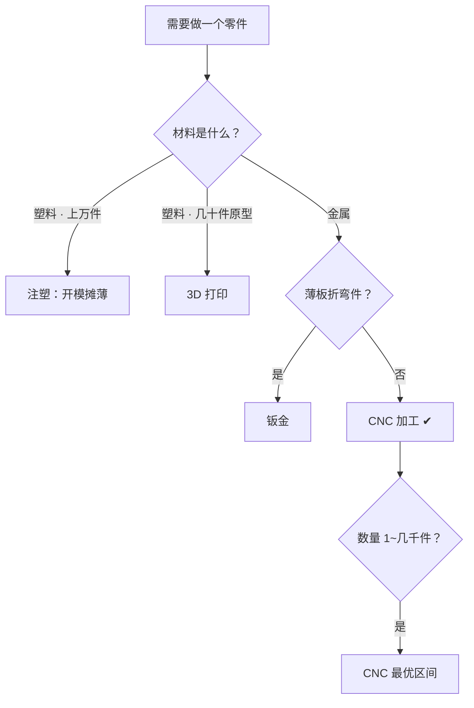

# 第 1 章 认识 CNC 加工

!!! note "本章解决什么问题"
    入行第一个问题：CNC 到底是什么？什么样的订单适合走 CNC？它和 3D 打印、钣金、注塑比，优势和劣势在哪？——不搞清这些，后面所有报价和谈判都是空中楼阁。

!!! abstract "本章的三条线"
    - **货物流**：坯料 → 装夹加工 → 去毛刺 → （外协表面处理）→ 成品——本章讲的正是货物流「加工」这一段如何发生；
    - **资金流**：CNC 按「机时＋材料」计费——本章解释资金流计价的物理基础；
    - **单据流**：一切从图纸开始——图纸是三条线的源头单据（第 5 章展开）。

## 一句话定义

CNC（Computer Numerical Control，计算机数字控制）加工＝**用程序控制的机床，把金属或塑料坯料切削成图纸要求的形状**。原材料是整块棒料或板料，机床按程序一点点「雕刻」掉多余部分——所以它也叫「减材制造」，与 3D 打印的「增材」、注塑的「成型」相对。

## 五大工艺家族

| 工艺 | 干什么 | 典型产出 | 白话类比 |
|---|---|---|---|
| 铣削（milling） | 刀具旋转，工件移动，削出平面、槽、孔、曲面 | 壳体、支架、结构件 | 高精度电动雕刻刀 |
| 车削（turning） | 工件旋转，刀具进给，切削回转体 | 轴、套、旋钮、螺柱 | 高级削笔刀 |
| 钻孔（drilling） | 打孔 | 螺栓孔、销孔 | 精确定位电钻 |
| 镗削（boring） | 把已有孔扩大并修准 | 高精度内孔 | 孔的内壁精修 |
| 磨削（grinding） | 磨料去除极少量材料，达到高精度与光洁 | 精密平面、轴颈 | 精细打磨 |

现代 CNC 加工厂多数用**加工中心**（machining center）：一台设备集铣、钻、镗于一体，配合数控车床（车铣复合）覆盖绝大多数订单。

## 替代工艺对比：什么时候选 CNC

| 维度 | CNC 加工 | 3D 打印 | 钣金 | 注塑 |
|---|---|---|---|---|
| 精度 | ★★★（±0.01~0.1mm 常规可达） | ★（层纹明显） | ★★ | ★★★（模具决定） |
| 材料 | 金属＋工程塑料，近乎全部 | 有限（树脂/尼龙为主） | 薄金属板 | 特定塑料 |
| 成本逻辑 | 按机时＋材料，小批量友好 | 按体积＋设备时长 | 按展开料＋折弯工时 | 模具费高，摊到件上才便宜 |
| 适用批量 | 1~几千件 | 1~几十件（原型） | 几十~几千件 | 数千件以上 |
| 典型场景 | 结构件、精密件、打样 | 外观原型、复杂内腔 | 机箱、支架、罩壳 | 大批量塑料壳 |

**判断口诀**：精度高、材料硬、数量在 1~几千件、金属材质——大概率选 CNC。数量再往上（上万件塑料件）就该谈注塑开模了。

## 成本结构初窥

CNC 报价的基本盘是「机时＋材料」：

- **机时**：机床运行时间×机时费。程序复杂、精度要求高、材料难切，机时就长；
- **材料**：坯料尺寸往往比成品大（要留装夹余量），切掉的碎屑也是成本；
- **Setup 与人工**：装夹、对刀、编程、检验——这是小批量单价高的根本原因：**一件的 Setup 摊不薄，500 件就能摊薄**；
- **表面处理**：阳极氧化、喷砂等通常外协，按炉或按件计费。

这套逻辑在第 10 章（成本与报价）会展开成完整的报价方法。

## 一张图选对工艺

## 自测

1. CNC 为什么叫「减材制造」？和 3D 打印的本质区别是什么？
2. 客户要 5000 件塑料外壳，你该推 CNC 还是建议注塑？为什么？
3. 五大工艺家族里，加工「一根精密传动轴」主要靠哪两种？
4. 为什么同样一个零件，打样 1 件的单价比 500 件的单价高出很多？

!!! tip "接下来学什么"
    知道了 CNC 是什么，下一章回答「那我在这行里扮演什么角色」——外贸服务商的价值从哪来、钱在哪个环节产生。

---

> 💬 **实操交流**：学到这里卡住了？加作者微信 **Kelegele**（备注「CNC学习」），知无不言。
