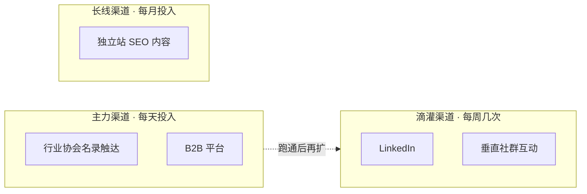

# 第 8 章 获客渠道

!!! note "本章解决什么问题"
    八条渠道各有打法——主力＋滴灌＋长线组合，两条主力跑通再扩。

!!! abstract "本章知识网络"
    ```mermaid
    graph LR
    A["八条渠道"] --> B["主力：名录触达＋B2B"]
    A --> C["滴灌：LinkedIn＋社群"]
    A --> D["长线：独立站 SEO"]
    A --> E["节奏：量 / 跟进 / 止损线"]
    ```

!!! abstract "本章的三条线"
    - **货物流**：三条线未动，信息先行——获客阶段你传递的是信息流；
    - **资金流**：触达话术里承诺什么（价格/时限/能力），就是后面资金流与单据流的基调——不轻诺；
    - **单据流**：渠道话术里对能力的描述，必须与工厂盘真实匹配。

## 八条渠道总览

| 渠道 | 成本 | 量级 | 意图强度 | 最适合的行业/买家 |
|---|---|---|---|---|
| LinkedIn | 免费（手动） | 中 | 中高 | 机器人/自动化/电子设备——找决策人 |
| 行业协会名录 | 免费-低 | 中（一次抓一批） | 中 | 有协会生态的行业（机器人、照明等） |
| Google 地图搜索 | 免费 | 大 | 中 | 本地小厂/工作室（工业区分批扫） |
| B2B 平台 | 免费-年费 | 大 | **高**（主动来找的人） | 渔具/消费五金/通用件 |
| 众筹平台截流 | 免费 | 小 | 高 | 硬件创新项目（键盘/EDC/无人机） |
| 垂直社群 | 免费（时间） | 小 | 中高 | 键盘/EDC/摄影等爱好者行业 |
| 独立站 SEO | 低（托管免费） | 长线复利 | 高（主动搜索） | 全行业，越老越值钱 |
| 展会 | 高（差旅/展位） | 集中 | 高 | 有预算后的加速器 |

## 每条渠道的三句话打法

1. **LinkedIn**：找「人」比找「公司」有用——用职位关键词（mechanical engineer / product manager / founder）锁定决策人，先看主页再发连接请求，附一句定制开场（提对方产品，不提自己）；
2. **协会名录/Google 地图**：一次抓一批结构化线索（公司名+网址+联系人），分诊分级（高价值/一般/排除），按名单逐个开官网确认在营再触达；
3. **B2B 平台**：买家主动发询盘、意图最强，但同一条询盘几十家抢——差异点在响应速度与回复专业度（要素问全、报价快）；
4. **众筹平台**：找正在做硬件项目的发起人，他们在找量产伙伴——去项目页找官网联系邮箱，**不要在众筹页留言打广告**（社区礼仪）；
5. **垂直社群**：先贡献（回答问题、分享工艺知识）再谈生意，信任攒够了订单自然来——周期长但客户质量最高；
6. **独立站 SEO**：写行业内容（工艺科普、选材指南），让买家搜索时找到你——长线资产，三个月起步；
7. **展会**：成本最高但见面信任最快，适合有稳定利润后投入；
8. **Google 地图**：搜工业区分批扫，小厂/工作室名单一抓一把，适合练手与铺量。

## 渠道组合策略

- **主力渠道**（每天固定投入）：选 1-2 条产出可衡量的（如名录触达＋B2B 平台）；
- **滴灌渠道**（每周几次）：LinkedIn 动态与社群互动，攒存在感；
- **长线渠道**（每月投入）：独立站内容，为一年后铺路。

**不要八条全开**——单人精力有限，两条主力跑通后再扩。

## 渠道组合一张图



## 触达节奏与止损线

- 每天固定量（如 5-10 条触达），记录到客户台账（名称/来源/日期/要点/下一步）；
- 首次触达后 3-5 天跟进一次（[9.2](l5-01.md) 句式 ⑩）；跟进两次无回复即归档，不无限追；
- **止损线**：触达量累计足够（50+）而回复率≈0 时，先改话术再换渠道——渠道没有错，话术可能有错。

## 自测

1. 八条渠道里，意图强度最高的是哪两条？代价分别是什么？
2. 为什么「众筹页留言打广告」是禁忌？正确的截流动作是什么？
3. 主力/滴灌/长线三类渠道的投入频率分别是什么？
4. 触达 50+ 无回复，你的前三个排查动作是什么？

!!! tip "接下来学什么"
    渠道打开、询盘进来，下一章（第 9 章）给你接询盘的全套武器：报价要素清单＋英语十句。

---

> 💬 **实操交流**：学到这里卡住了？加作者微信 **Kelegele**（备注「CNC学习」），知无不言。
