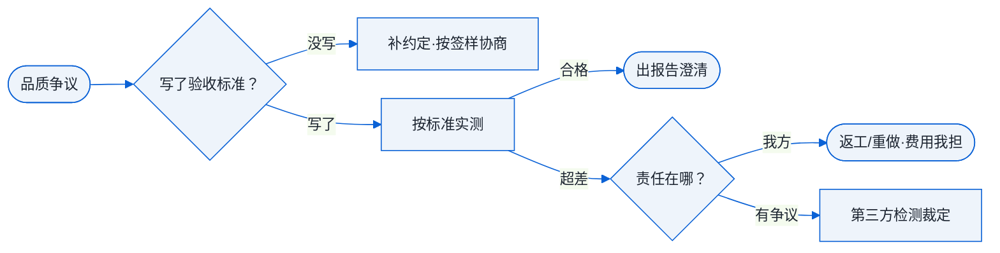

# 第 14 章 品质与验收

!!! note "本章解决什么问题"
    「货好不好，谁说了算？」——没有事先约定的验收标准，品质问题就变成各说各话。这一章讲检验方式、检测手段和常见争议的处理路径，让你在出货前就把「好不好」的定义锁死。

!!! abstract "本章的三条线"
    - **货物流**：四类争议（尺寸超差/氧化色差/刀纹/变形）都是货物偏离定义的情形，各有处理路径；
    - **资金流**：品质问题最终都落到资金流上（返工费/赔偿/折扣）——先约定后发生；
    - **单据流**：检验报告与尺寸报告＝单据流为货物流背书的正式文件。

## 验收标准：写在前面才有效

争议的根源几乎都是「标准没约定」。出货前把三件事写进 PI 或确认邮件：

1. **按什么判定**：按签样（approved sample）或按图纸公差；
2. **关键指标**：关键尺寸公差、表面粗糙度 Ra、氧化颜色（留色板）、外观标准；
3. **检验方式**：全检还是抽检，谁来检。

## 检验方式：全检与抽检

| 方式 | 逻辑 | 适用 |
|---|---|---|
| 全检 | 每件都量 | 精密件、小批量（<100 件）、关键尺寸 |
| 抽检 | 按比例抽样判定整批 | 大批量；抽检标准常用 **AQL**（Acceptable Quality Level，可接受质量水平，如 AQL 1.0/2.5） |

**抽检的本质**：用统计学抽查推断整批合格率——抽样数与判定规则按 AQL 表查。小批量定制件建议关键尺寸全检（成本可控），外观抽检。

## 检测手段阶梯

| 手段 | 精度 | 能测什么 | 报告可信度 |
|---|---|---|---|
| 游标卡尺 | ±0.02mm 级 | 长度、外径、内径 | 日常抽检够用 |
| 千分尺 | ±0.01mm 级 | 精密外径/厚度 | 关键尺寸 |
| CMM（三坐标测量机） | 微米级 | 全尺寸+形位公差 | 出具正式 dimensional report（尺寸检测报告），争议裁定用 |

**注意工厂的检测能力**：有些厂没有 CMM——高精密件要提前确认「谁来出报告」，必要时送第三方检测。

## 四类常见争议与处理路径

| 争议 | 判定依据 | 处理路径 |
|---|---|---|
| 尺寸超差 | 图纸公差＋检测报告 | 我方责任→返工/重做；公差边缘→与客户协商 |
| 氧化色差 | 色板/签样比对 | 染色批次差异→与氧化厂交涉；无签样→协商（所以要签色板） |
| 表面刀纹 | Ra 标准＋签样外观 | 未达 Ra→精铣返工；签样认可→引导客户协商 |
| 变形（平面度） | 平面度标注＋氧化前后 | 追溯签样与工序记录→工艺补救或重做 |

**通用处理顺序**：签样/报告比对 → 双方认可事实 → 方案（返工/重做/折扣让步）→ 复盘归档。

## 第三方验货

- **何时用**：大额订单、客户要求、双方检测结论冲突时——第三方机构（验货公司/检测实验室）出具中立报告；
- **费用谈判**：一般「谁主张谁承担」，双方争议时各半或败诉方承担；
- **替代方案**：客户委托的当地验货师上门验货，也常见且成本更低。

## 品质争议处理路径

## 自测

1. 验收标准必须写在出货前，具体要约定哪三件事？
2. AQL 抽检的逻辑是什么？小批量定制件为什么建议关键尺寸全检？
3. 客户投诉氧化颜色不对，你手头没有色板——这个争议说明了什么流程缺失？
4. 双方对尺寸是否超差各执一词，下一步用什么手段裁定？

!!! tip "接下来学什么"
    品质锁死了，最后一章讲「把一单变成长期生意」：售后、复购与客户管理。

---

> 💬 **实操交流**：学到这里卡住了？加作者微信 **Kelegele**（备注「CNC学习」），知无不言。
