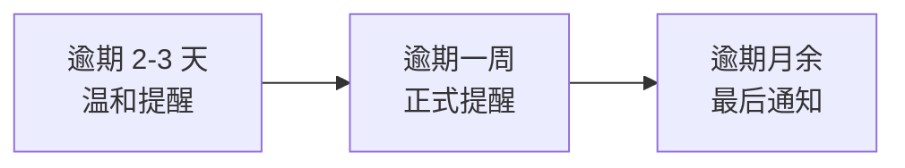

# 英语 · 场景 5：付款与催款

!!! note "这个场景什么时候用"
    货出了、发票开了，钱还没到——催款是外贸最微妙的一门英语：既要钱，又要留关系。这一场景给你从委婉提醒到正式催告的分级句式。

## 核心单词（10 个）

| 英文 | 中文 | 常见搭配 |
|---|---|---|
| balance payment | 尾款 | balance due 尾款到期 |
| bank slip / transfer receipt | 银行水单 | bank slip attached |
| overdue | 逾期 | payment overdue |
| reminder | 提醒 | gentle reminder |
| receipt | 收据 | receipt confirmed |
| T/T (telegraphic transfer) | 电汇 | pay by T/T |
| due date | 到期日 | due on June 10 |
| outstanding | 未付的 | outstanding amount 未付金额 |
| partial payment | 部分付款 | accept partial payment |
| credit note | 贷记单（冲抵凭证） | issue a credit note |

!!! abstract "本章的三条线"
    - **货物流**：货物已交付，此场景只剩两条线在动；
    - **资金流**：从 gentle reminder 到 formal notice，逐级催动资金流；
    - **单据流**：bank slip（水单）＝资金流的收付凭证。

## 三级催款（逐级升级，不伤关系）

### 一级 · 温和提醒（到期日当天或逾期 2-3 天）

> Hi [Name],
>
> Gentle reminder — the balance payment (USD 3,095) for order #2309 was due yesterday. Could you arrange it at your convenience?
>
> If it's already on the way, please ignore this note — and if you need the invoice again, just say the word.
>
> Best regards,
> [Your name]

### 二级 · 正式提醒（逾期一周左右）

> Hi [Name],
>
> Following up on the outstanding balance of USD 3,095 (order #2309), which is now one week past the due date.
>
> Could you let us know the expected payment date? If there's any issue with the parts or the paperwork, please tell us — we'd rather fix that first.
>
> Best regards,
> [Your name]

### 三级 · 最后通知（逾期月余）

> Hi [Name],
>
> This is a formal notice regarding the outstanding balance of USD 3,095 for order #2309, now 30 days overdue.
>
> We value our cooperation and would like to resolve this smoothly. However, until the payment is settled, we're unable to accept new orders or release shipment documents for future orders.
>
> Please let us know your payment plan by [date].
>
> Best regards,
> [Your name]

**升级逻辑**：一级给台阶（可能忘了/在途）→ 二级给出口（有问题先说）→ 三级划底线（新单暂停）。每级都留了「关系仍然存在」的信号。

## 收款确认（收到水单后）

> Hi [Name],
>
> Bank slip received — thank you! The balance of USD 3,095 has been confirmed, and the shipment documents are on their way.
>
> Best regards,
> [Your name]

## 三级催款升级

## 场景练习

**练习 1 · 填空**：
1. The balance ______ is due on June 10.
2. Payment is now one week ______.
3. Please send the bank ______ once transferred.

**练习 2 · 中译英**：
1. 温和提醒一下，订单 2309 的尾款昨天到期了。
2. 在款项结清之前，我们无法接新订单。

**练习 3 · 改写（升级要留关系）**：
"Pay now or we report you."

??? success "参考答案"
    **练习 1**：1. payment　2. overdue　3. slip
    **练习 2**：1. Gentle reminder — the balance payment for order #2309 was due yesterday.　2. Until the payment is settled, we're unable to accept new orders.
    **练习 3**：This is a formal notice regarding the outstanding balance. We value our cooperation and hope to resolve this quickly — please let us know your payment plan by Friday.

---

> 💬 **实操交流**：学到这里卡住了？加作者微信 **Kelegele**（备注「CNC学习」），知无不言。
