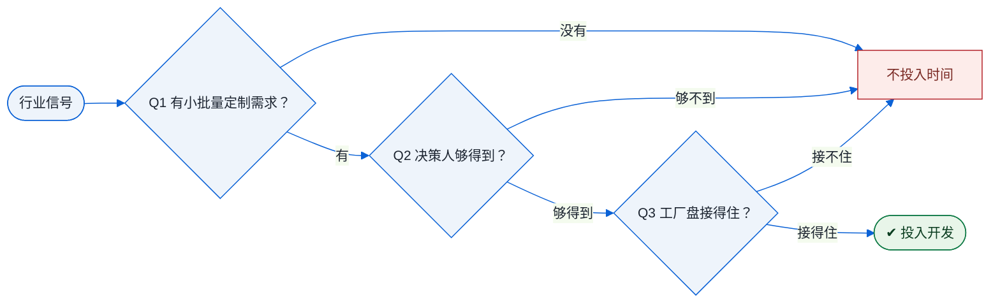

# 第 6 章 · 买家地图：谁在买 CNC 件

!!! note "本章解决什么问题"
    客户不是找来的，是从「需要定制金属件的行业」里筛出来的。

!!! abstract "本章知识网络"
    ```mermaid
    graph LR
    A["买家地图"] --> B["心智模型＝中间件"]
    A --> C["需求地图 · 10 行业"]
    A --> D["三问过滤器"]
    A --> E["生态位<br/>被 MOQ 和价格劝退的买家"]
    ```

!!! abstract "本章的三条线"
    - **货物流**：不同行业的「件」决定了货物流形态——打样小件走快递、批量走海空运；
    - **资金流**：行业决定订单节奏——机器人「小批量高频」意味着资金流细水常流，比单笔大单更稳；
    - **单据流**：越专业的行业，单据要求越严格（检测报告、材质证明）——选行业也在选单据复杂度。

## 一个心智模型，先立住

**CNC 件不是终端商品，是「按图纸定制的中间件」。** 没有消费者走进商店买「一个 CNC 铝件」——买家买的从来不是产品本身，而是「把我的图纸变成实物」的能力。

所以「CNC 外贸的市场在哪」这个问题，正确的打开方式不是找「CNC 行业」，而是找那些**需要少量定制金属件的行业**。下面的地图就是这些行业，按六类买家场景组织。

## 需求地图

| 行业 | 典型 CNC 件 | 为什么买（场景） | 决策人 | 常见触达渠道 |
|---|---|---|---|---|
| 机器人/自动化 | 结构件、夹具（fixture＝固定工件的工装）、末端执行器 | 设计迭代快→打样频繁；量小（5-50 件）但复购稳定 | 机械工程师/研发主管 | LinkedIn、行业协会会员名录 |
| 灯具/照明 | 散热器、外壳、连接件 | 定制造型＋铝散热＋阳极氧化，是机加工的强项组合 | 产品经理/NPI（New Product Introduction，新产品导入岗） | 行业展会、Google 行业名录 |
| 无人机 | 机臂、电机座、相机笼 | 轻量化铝件、小批量、迭代快 | 创始人/发烧友 | 社群论坛、众筹平台 |
| 电子/半导体设备 | 非标支架、面板、治具（jig＝定位工装） | 设备品种多、每种量少、公差要求中高 | 设备工程师/采购 | 行业展会、B2B 平台 |
| 医疗设备 | 高公差精密件 | ⚠️ 通常要求 ISO13485（医疗器械质量体系认证），无此资质的服务商应谨慎 | 合规/采购 | 认证门槛高，新手不建议碰 |
| 键盘客制化 | 外壳、配重块、旋钮 | GB（Group Buy，团购拼单）模式，审美驱动，100-1000 件 | 团购发起人/微品牌 | 键盘社群、Reddit、Discord |
| EDC/桌面美学 | 随身小五金、摆件（EDC＝Everyday Carry，随身装备） | 社群审美消费，单值小复购高 | DTC（Direct to Consumer，直面消费者）微品牌 | Instagram、TikTok 标签 |
| 渔具/户外 | 路亚配件、结构件 | 小品牌需要快速试款 | 小品牌主 | B2B 平台、品牌官网联系页 |
| 汽车改装 | 支架、旋钮、内饰件 | ⚠️ 涉安全件有合规责任，新手谨慎 | 改装店/品牌 | 展会、社群 |
| 光学/摄影 | 快装板、相机笼 | 小众但忠诚、复购稳定 | 微品牌 | 摄影社群、众筹平台 |

**读表方法**：每一行回答三个问题——这行业的「件」长什么样？他们为什么需要外部加工？谁签字下单？三个答案凑齐，触达渠道自然浮出来。

## 商业逻辑三课

### 第一课：打样 → 量产漏斗

打样（几十到几百美元）本质是「买信任」——客户用小单试探你，真正的利润在复购量产。一个零件的生命周期＝打样 → 小批量（50-500 件）→ 量产（1000+ 件）。

**个人服务商的机会在前两段**：打样和大货之间有一段「工厂嫌单小、大贸易商嫌流程麻烦」的缝隙地带，这正是低起订量服务的生态位。

### 第二课：定价逻辑

行业常见的做法是**按项目分项报价**：材料＋机时＋表面处理＋检验＋包装运费＋服务费，整体以工厂成本为基础加价 15%-30% 起谈（具体幅度以你自身的成本核算与市场行情为准）。

小批量单价高是常态，不用心虚——买家付的溢价买的是三样东西：**不开模**（无模具费）、**不用飞中国**（沟通成本）、**快**。

### 第三课：竞争生态位

你抢的不是工厂的直客，而是三类「被劝退」的买家：

1. 被工厂 MOQ（Minimum Order Quantity，最小起订量）劝退的小买家；
2. 被本地机加房价格劝退的买家——欧美本地机加工价格通常是中国的数倍；
3. 需要英文沟通＋一站式服务的买家。

平台型对手（如 Xometry 等即时报价平台）快但贵；本地机加房快但贵；工厂便宜但语言与起订量门槛高——**三者之间的缝隙，就是个人服务商的位置**。

## 三问过滤器：这个市场值不值得投入

见到任何行业信号，先过三问：

1. 这个行业有没有「小批量定制金属件」需求？
2. 决策人是谁？我够得到哪个触达渠道？
3. 我合作的工厂盘（材料、轴数、表面处理能力）接得住这类件吗？

**三问过不了两个，不投入开发时间。** 时间是你单人作战最贵的资源。

## 三问过滤器 · 决策图



## 自测

1. 「CNC 件是中间件」这个心智模型，如何改变你找客户的方式？
2. 机器人行业为什么是典型的「小批量＋复购」市场？
3. 三问过滤器里，第三问为什么是问「我的工厂盘」而不是「市场大不大」？
4. 找一个你熟悉的行业（不限于表内），试着填一遍表格的五列。

!!! tip "接下来学什么"
    教科书路线的下一站是[第 7 章 · 市场与证据](ch07.md)——把「买家在哪」升级为「市场值不值得投」；急于上手的人也可以跳到[第 9 章 · 询盘处理](l1-01.md)。

---

> 💬 **实操交流**：学到这里卡住了？加作者微信 **Kelegele**（备注「CNC学习」），知无不言。
